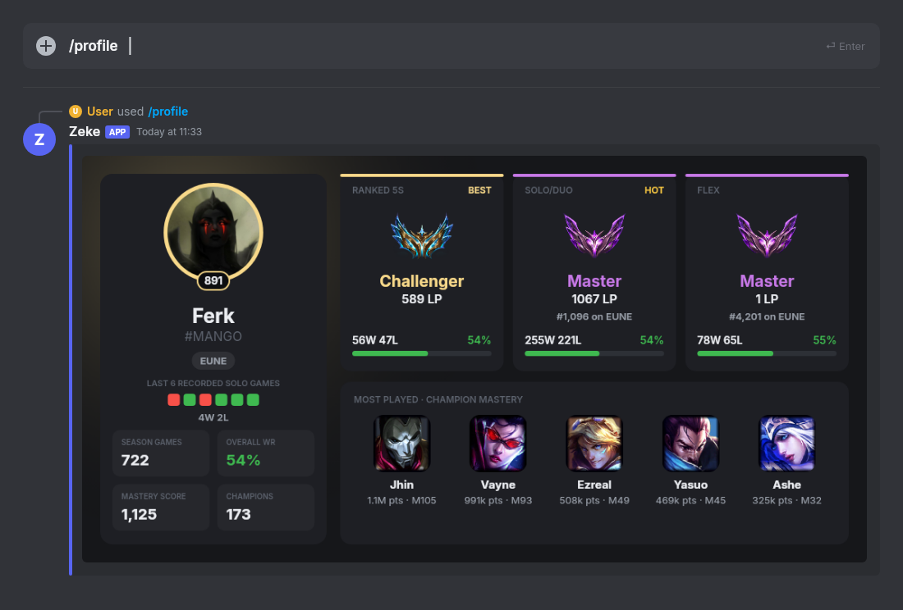
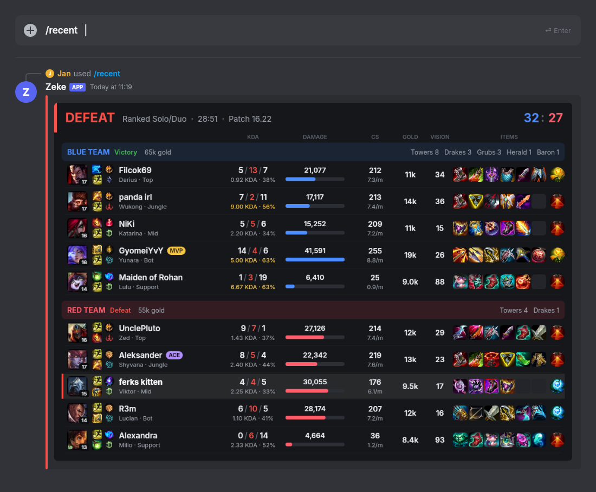
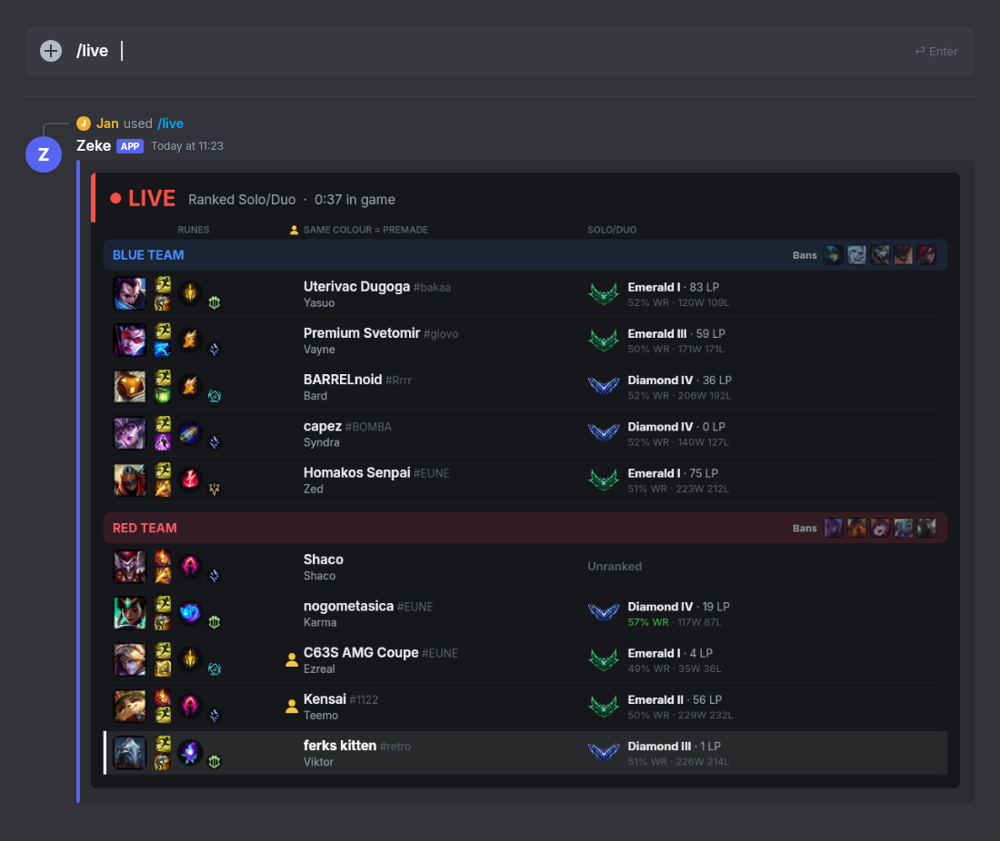
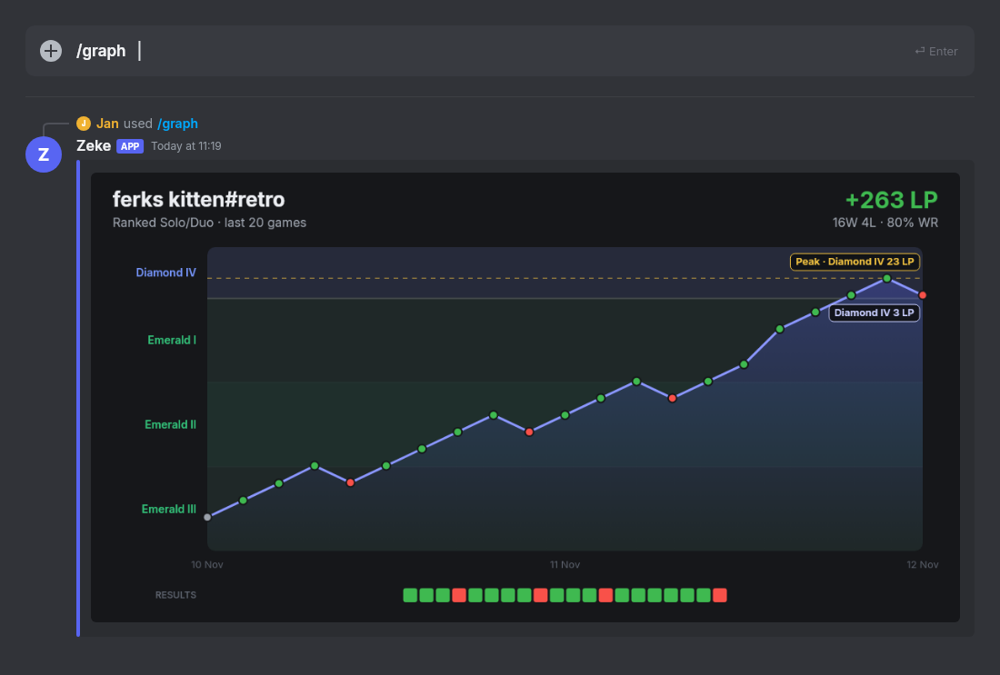
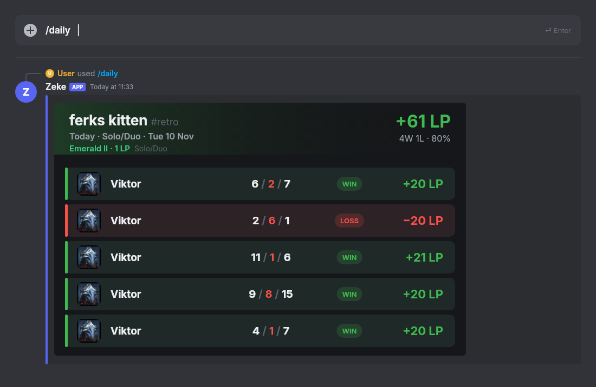
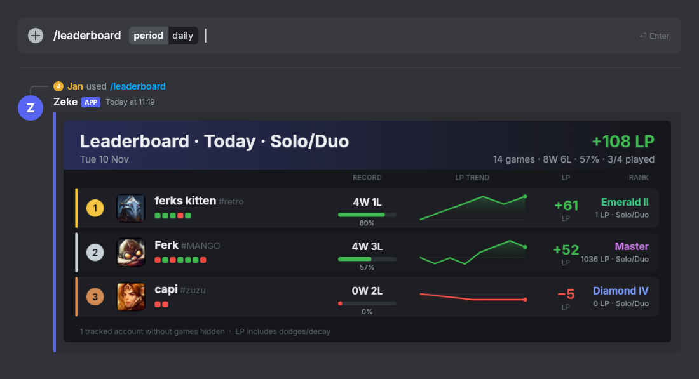
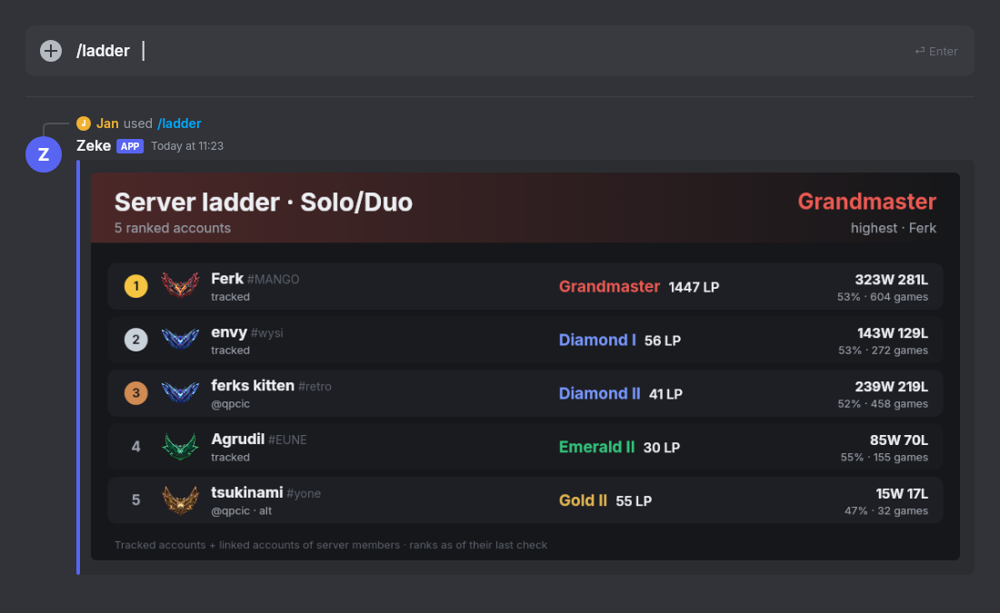
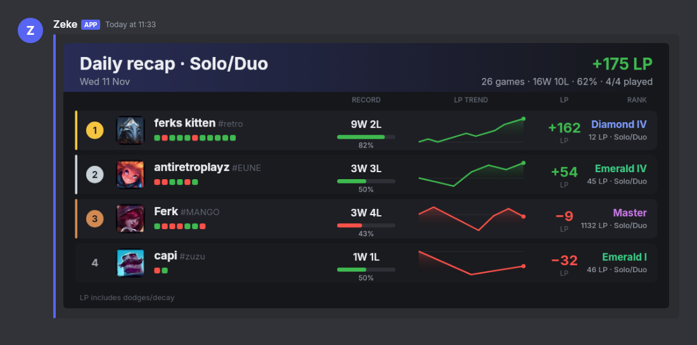
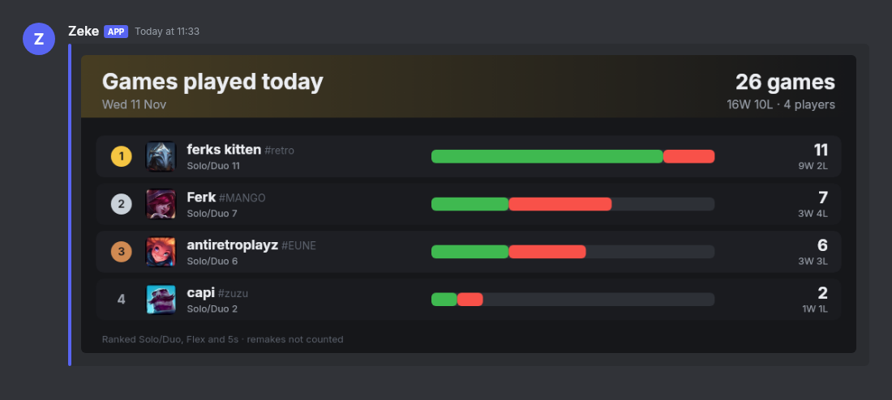
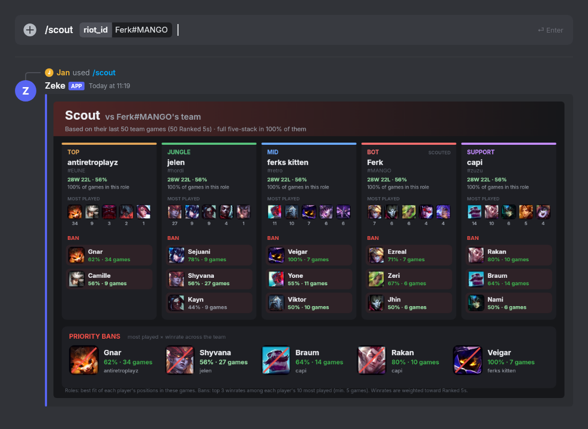

# Zeke

**A League of Legends companion for Discord.**
Zeke records every ranked game and LP change for your friends, and turns them into clean, shareable cards:
profiles, scoreboards, daily and weekly recaps, LP graphs, server leaderboards and Scout reports for premade 5v5.

[Features](#features) · [Commands](#commands) · [How it works](docs/how-it-works.md)

  

## Features

- **Automatic LP tracking:** link your Riot ID once (alts too). Zeke watches for finished ranked games in the background and records the exact LP gained or lost in each one, including promotions, demotions, remakes, dodges and decay.
- **Profile cards:** Solo/Duo, Flex and Ranked 5s ranks side by side (best first), W/L, ladder position for Master+, top champions and mastery stats.
- **Server recaps & game log:** pick a channel with `/recap` and every night the day's leaderboards are posted there automatically, with the week's on Mondays. `/log` posts every game of the tracked accounts to a channel.
- **Live games:** `/live` shows both teams of the game you're in right now, with each player's rank for that queue, all their runes, spells and bans.
- **Match scoreboards:** your latest game as a full 10-player scoreboard with items, runes, damage and MVP/ACE badges.
- **Personal recaps:** `/daily` and `/weekly` list every game from today (or the past 24 hours) or the past 7 days with champion, KDA, result and LP, plus the net total.
- **LP graphs:** your climb over the last games, drawn on the tier and division ladder with your peak marked.
- **Server leaderboards:** who climbed the most in the past 24 hours or 7 days, with win/loss, LP trend and current rank.
- **Scout:** type one name from the enemy Ranked 5s or Flex team. Zeke finds their five-stack, works out each player's role and best champions, and suggests what to ban. One-tricks get an OTP badge and go to the top of the ban list.
- **Champion stats:** `/champ` shows how you do on one champion: W/L, KDA, CS and damage per minute, kill participation, LP and recent games.
- **Role stats:** `/roles` shows winrate, KDA, CS/min and top champions per position, with your best and worst role marked.
- **Duos and rivals:** `/duo @friend` is your record together and your best champion pairs; `/rivals @friend` is the head-to-head when you were on opposite teams.
- **LP race:** `/graph` with several players draws everyone's LP on one chart, so a server race is easy to follow.
- **Peak rank:** `/peak` shows the highest rank in each queue since tracking started.
- **Server ladder:** `/ladder` lists everyone in the server by current rank, alts included.
- **Game log and rank posts:** every game of the tracked accounts is posted as a scoreboard the moment it's spotted and updated when the LP comes in, plus a post for every promotion and demotion.
- **Bets:** when a tracked player starts a ranked game, Zeke posts the draft (like `/live`: ranks, premades, who they've played with and against) with **Bet Win** / **Bet Lose** buttons. Points aren't real; `/points` has the server's richest.
- **Short names:** accounts Zeke already knows work with part of the name: `$r kitten` finds `ferks kitten#retro`.
- **Solo/Duo, Flex and Ranked 5s kept separate**, and every command also works with a `$` prefix (`$p`, `$rs`, `$lb`…).

<table>
  <tr>
    <td align="center"> <code>/recent</code> · full scoreboard of the latest game</td>
  </tr>
  <tr>
    <td align="center"> <code>/live</code> · the game you're in right now: both teams with ranks, runes, spells, bans and premades</td>
  </tr>
  <tr>
    <td align="center"> <code>/graph</code> · LP over your last games on the rank ladder, peak marked</td>
  </tr>
  <tr>
    <td align="center"> <code>/daily</code> · today's games and LP</td>
  </tr>
  <tr>
    <td align="center"> <code>/leaderboard</code> · who climbed in the past 24h</td>
  </tr>
  <tr>
    <td align="center"> <code>/ladder</code> · everyone in the server by current rank, alts included</td>
  </tr>
  <tr>
    <td align="center"> <code>/recap</code> · posted every night after midnight: the day's LP leaderboard, one per queue played…</td>
  </tr>
  <tr>
    <td align="center"> …followed by who played the most games. On Mondays the weekly recap comes after.</td>
  </tr>
  <tr>
    <td align="center"> <code>/scout</code> · scout a premade: roles, best champions and what to ban</td>
  </tr>
</table>

## Commands

Every command works as a slash command and as a message with the `$` prefix. With no account given, a command shows **your** main linked account (`/recent` shows your newest game on any of your linked accounts). You can also pass `@someone` (their main account) or any Riot ID like `Name#TAG`. Accounts Zeke already knows also work with just part of the name: `$r kitten` finds `ferks kitten#retro` (case and spaces don't matter, regex works too, and if two accounts match Zeke lists them). Scout takes short names as well: `$scout kitten mapet fram`.

### You

| Command | What it does |
|---|---|
| `/zeke` | Short intro, getting started and links (support server, invite, GitHub, terms) · `$zeke` |
| `/help` | All commands · `$help` |
| `/link [Name#TAG] [region]` | Your linked accounts, with buttons to add one, remove one or pick your main. The first account is your main, later ones are alts · `$link euw Name#TAG` |
| `/unlink [account]` | Remove a linked account. If it was your main, your oldest alt becomes main |
| `/mode [solo\|flex\|5s]` | Set your default queue for stats commands (Solo/Duo unless changed; `/recent` ignores it) · `$mode 5s` |
| `/profile [@user \| Name#TAG]` | Profile card: ranks, W/L, ladder position, top champions · `$p` |
| `/live [@user \| Name#TAG]` | The game you're in right now (from the loading screen on): both teams with ranks, runes, spells and bans. Checks all your linked accounts · `$lg` |
| `/recent [@user \| Name#TAG] [solo\|flex\|5s]` | Scoreboard of the latest ranked game, any queue unless you name one · `$rs` |
| `/daily [@user \| Name#TAG] [24h] [solo\|flex\|5s]` | Today's games and LP; add `24h` for the past 24 hours instead · `$d` |
| `/weekly [@user \| Name#TAG] [solo\|flex\|5s]` | Games and LP from the past 7 days · `$w` |
| `/champ [champion] [@user \| Name#TAG]` | Your games on one champion from your last 50 ranked games: W/L, KDA, CS and damage per minute, kill participation, LP, recent games. Defaults to your most played · `$champ lee sin`, `$c ahri` |
| `/peak [@user \| Name#TAG]` | Highest rank in each queue since tracking started, with the date and whether they're there right now · `$peak` |
| `/duo @user \| Name#TAG` | Your record playing on the same team: W/L, queues, recent streak and best champion pairs · `$duo`, `$together` |
| `/rivals @user \| Name#TAG` | Head-to-head when you were on opposite teams: score, same-lane games, KDA and most-played picks · `$rivals`, `$vs`, `$h2h` |
| `/graph [@user \| Name#TAG] [games] [solo\|flex\|5s]` | LP graph over recorded games · `$g` |
| `/graph compare:@a, kitten [days]` | LP race: up to 6 players on one chart over the last 14 days (or `days`), with each player's net LP and W/L · `$graph @a @b`, `$graph kitten, mapet 30`, `$graph vs @a` (you vs them) |
| `/roles [@user \| Name#TAG] [solo\|flex\|5s]` | Winrate, KDA, CS/min and top champions per position over the last 50 ranked games, best and worst role marked · `$roles`, `$pos` |
| `/mmr [@user \| Name#TAG] [games] [solo\|flex\|5s]` | Average current rank of the enemies and teammates in your last 10 (up to 20) games, next to your own rank: a hint whether your hidden MMR is above or below it · `$mmr`, `$lobby` |
| `/scout <Name#TAG> [region] [player_2…5]` | One player: scout their usual Ranked 5s / Flex team from the last 30 games (Ranked 5s first). Up to 5 players: scout each one from their own last 30 ranked games (Ranked 5s first, then the most recent Flex or Solo/Duo), with roles fitted across them and how often they queue together. Roles, best champs, bans · `$scout fram#polar Mapet#MR10 eune` |

### Server

| Command | What it does |
|---|---|
| `/leaderboard <daily\|weekly> [solo\|flex\|5s]` | LP leaderboard of the server's tracked accounts, past 24h or 7 days · `$lb` |
| `/track add <region> <Name#TAG>` | Add an account to the server leaderboard *(Manage Server)* |
| `/track remove <account>` | Remove an account from the leaderboard *(Manage Server)* |
| `/ladder [solo\|flex\|5s]` | Everyone in the server by current rank: tracked accounts plus every linked account (alts too) of server members · `$ladder` |
| `/track list` | Show tracked accounts |
| `/recap` | Daily recap: pick a channel, and every night just after midnight the day's LP leaderboard (one per queue played), a games-played leaderboard and the day's awards and rank changes are posted there. On Mondays the weekly recap follows *(Manage Server)* · `$recap #channel`, `$recap off` |
| `/log` | Game log: pick a channel and every new ranked game of the tracked accounts is posted there as a scoreboard, once per game, plus promotions and demotions *(Manage Server)* · `$log #channel`, `$log off` |
| `/bets #channel` | Bets: when a tracked player starts a ranked game, Zeke posts it there with **Bet Win** / **Bet Lose** buttons. Bets close after 5 minutes and pay 2x; remakes refund. Betting needs a linked account (`/link`), and anyone playing in the game can't bet on it. Points are per server and not real (everyone starts with 1000, a bailout tops broke players up to 100) *(Manage Server)* · `$bets #channel`, `$bets off` |
| `/points [@user]` | Bet points, record and the richest in the server · `$points`, `$pts`, `$bal` |
| `/server` | Tracked accounts, timezone, and the recap and game log channels |

**Good to know**
- **Queue** is always the last argument: `$daily @friend flex`, `$lb week flex`. Without one, your `/mode` is used, which is Solo/Duo unless you change it.
- **Region** is only needed the first time Zeke sees an account: `$p ferks kitten#retro eune`. Game names with spaces work.
- **Accounts are tracked across servers:** once anyone links, tracks or looks up an account, its games are recorded everywhere. Removing it from a server only takes it off that server's leaderboard.
- **History starts when tracking does.** Riot doesn't keep LP history, so graphs and recaps fill up from the moment an account is first added.
- **Personal commands work anywhere** (servers, DMs, group chats) if you install the app to your account. Server commands need Zeke in the server. `$` commands work wherever the bot is a member.
- `$help` lists everything.

## Tech

TypeScript on Node.js 22+ · discord.js · built-in `node:sqlite` · `@napi-rs/canvas` for the images · Riot API (account-v1, league-v4, match-v5, champion-mastery-v4, summoner-v4) · Data Dragon / CommunityDragon for icons. The tests run against a simulated Riot API (`npm test`). [How it works →](docs/how-it-works.md)

---

[Terms of Service](docs/terms-of-service.md) · [Privacy Policy](docs/privacy-policy.md)

Zeke isn't endorsed by Riot Games and doesn't reflect the views or opinions of Riot Games or anyone officially involved in producing or managing Riot Games properties. Riot Games, and all associated properties are trademarks or registered trademarks of Riot Games, Inc.
