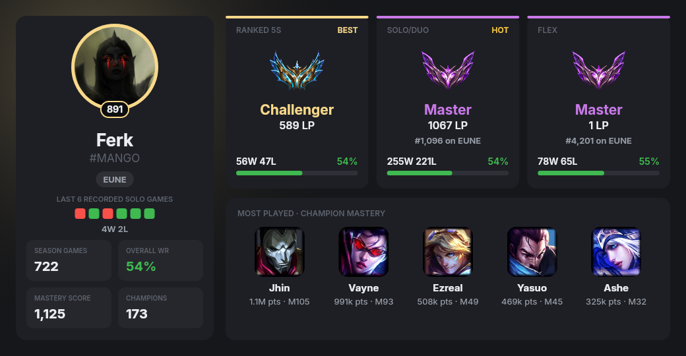
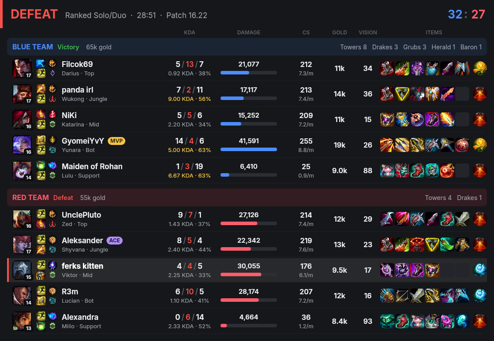
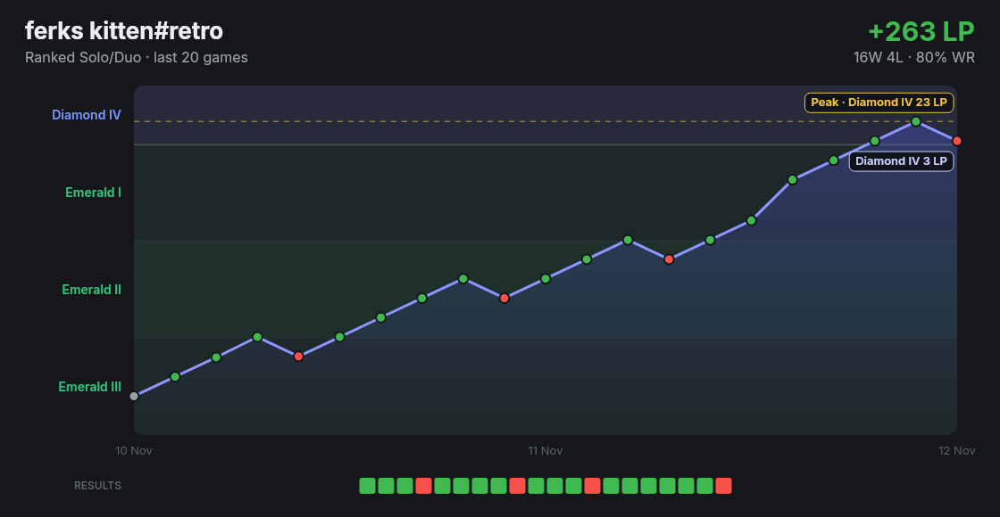
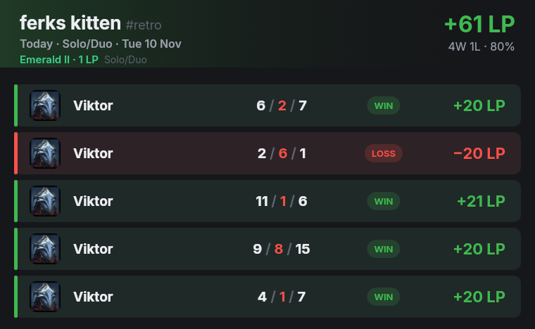
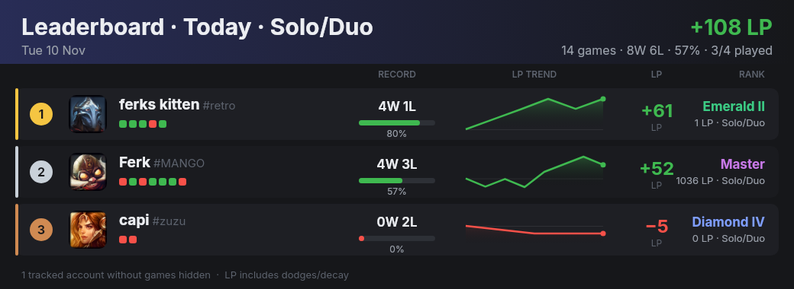
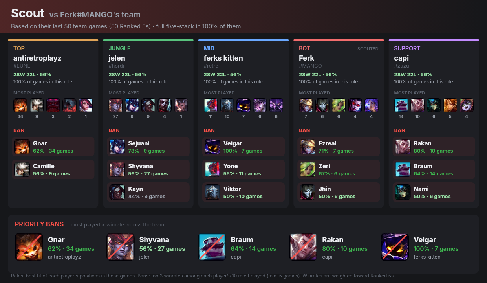

# Zeke

**A League of Legends companion for Discord.**
Zeke records every ranked game and LP change for your friends, and turns them into clean, shareable cards:
profiles, scoreboards, daily and weekly recaps, LP graphs, server leaderboards and Scout reports for premade 5v5.

[Features](#features) · [Commands](#commands) · [How it works](docs/how-it-works.md)

  

## Features

- **Automatic LP tracking:** link your Riot ID once (alts too). Zeke watches for finished ranked games in the background and records the exact LP gained or lost in each one, including promotions, demotions, remakes, dodges and decay.
- **Profile cards:** Solo/Duo, Flex and Ranked 5s ranks side by side (best first), W/L, ladder position for Master+, top champions and mastery stats.
- **Live games:** `/live` shows both teams of the game you're in right now, with each player's Solo/Duo and Flex rank, runes, spells and bans.
- **Match scoreboards:** your latest game as a full 10-player scoreboard with items, runes, damage and MVP/ACE badges.
- **Daily and weekly recaps:** every game from today (or the past 24 hours) or the past 7 days with champion, KDA, result and LP, plus the net total.
- **LP graphs:** your climb over the last games, drawn on the tier and division ladder with your peak marked.
- **Server leaderboards:** who climbed the most in the past 24 hours or 7 days, with win/loss, LP trend and current rank.
- **Scout:** type one name from the enemy Ranked 5s or Flex team. Zeke finds their five-stack, works out each player's role and best champions, and suggests what to ban.
- **Solo/Duo and Flex kept separate**, and every command also works with a `$` prefix (`$p`, `$rs`, `$lb`…).

<table>
  <tr>
    <td align="center"> <code>/recent</code> · full scoreboard of the latest game</td>
  </tr>
  <tr>
    <td align="center"> <code>/graph</code> · LP over your last games on the rank ladder, peak marked</td>
  </tr>
  <tr>
    <td align="center"> <code>/daily</code> · today's games and LP</td>
  </tr>
  <tr>
    <td align="center"> <code>/leaderboard</code> · who climbed in the past 24h</td>
  </tr>
  <tr>
    <td align="center"> <code>/scout</code> · scout a premade: roles, best champions and what to ban</td>
  </tr>
</table>

## Commands

Every command works as a slash command and as a message with the `$` prefix. With no account given, a command shows **your** main linked account (`/recent` shows your newest game on any of your linked accounts). You can also pass `@someone` (their main account) or any Riot ID like `Name#TAG`.

### You

| Command | What it does |
|---|---|
| `/link [Name#TAG] [region]` | Your linked accounts, with buttons to add one, remove one or pick your main. The first account is your main, later ones are alts · `$link euw Name#TAG` |
| `/unlink [account]` | Remove a linked account. If it was your main, your oldest alt becomes main |
| `/mode [solo\|flex\|5s]` | Set your default queue for stats commands (Solo/Duo unless changed; `/recent` ignores it) · `$mode 5s` |
| `/profile [@user \| Name#TAG]` | Profile card: ranks, W/L, ladder position, top champions · `$p` |
| `/live [@user \| Name#TAG]` | The game you're in right now (from the loading screen on): both teams with ranks, runes, spells and bans. Checks all your linked accounts · `$lg` |
| `/recent [@user \| Name#TAG] [solo\|flex\|5s]` | Scoreboard of the latest ranked game, any queue unless you name one · `$rs` |
| `/daily [@user \| Name#TAG] [24h] [solo\|flex\|5s]` | Today's games and LP; add `24h` for the past 24 hours instead · `$d` |
| `/weekly [@user \| Name#TAG] [solo\|flex\|5s]` | Games and LP from the past 7 days · `$w` |
| `/graph [@user \| Name#TAG] [games] [solo\|flex\|5s]` | LP graph over recorded games · `$g` |
| `/scout <Name#TAG> [region]` | Scout that player's Ranked 5s / Flex team: roles, best champs, bans · `$scout` |

### Server

| Command | What it does |
|---|---|
| `/leaderboard <daily\|weekly> [solo\|flex\|5s]` | LP leaderboard of the server's tracked accounts, past 24h or 7 days · `$lb` |
| `/track add <region> <Name#TAG>` | Add an account to the server leaderboard *(Manage Server)* |
| `/track remove <account>` | Remove an account from the leaderboard *(Manage Server)* |
| `/track list` | Show tracked accounts |
| `/recap` | Daily recap: pick a channel and every night just after midnight the day's server leaderboard is posted there, one image per queue played *(Manage Server)* · `$recap #channel`, `$recap off` |

**Good to know**
- **Queue** is always the last argument: `$daily @friend flex`, `$lb week flex`. Without one, your `/mode` is used, which is Solo/Duo unless you change it.
- **Region** is only needed the first time Zeke sees an account: `$p ferks kitten#retro eune`. Game names with spaces work.
- **Accounts are tracked across servers:** once anyone links, tracks or looks up an account, its games are recorded everywhere. Removing it from a server only takes it off that server's leaderboard.
- **History starts when tracking does.** Riot doesn't keep LP history, so graphs and recaps fill up from the moment an account is first added.
- **Personal commands work anywhere** (servers, DMs, group chats) if you install the app to your account. Server commands need Zeke in the server. `$` commands work wherever the bot is a member.
- `$help` lists everything.

## Tech

TypeScript on Node.js 22+ · discord.js · built-in `node:sqlite` · `@napi-rs/canvas` for the images · Riot API (account-v1, league-v4, match-v5, champion-mastery-v4, summoner-v4) · Data Dragon / CommunityDragon for icons. The tests run against a simulated Riot API (`npm test`). [How it works →](docs/how-it-works.md)

---

[Terms of Service](docs/terms-of-service.md) · [Privacy Policy](docs/privacy-policy.md)

Zeke isn't endorsed by Riot Games and doesn't reflect the views or opinions of Riot Games or anyone officially involved in producing or managing Riot Games properties. Riot Games, and all associated properties are trademarks or registered trademarks of Riot Games, Inc.
